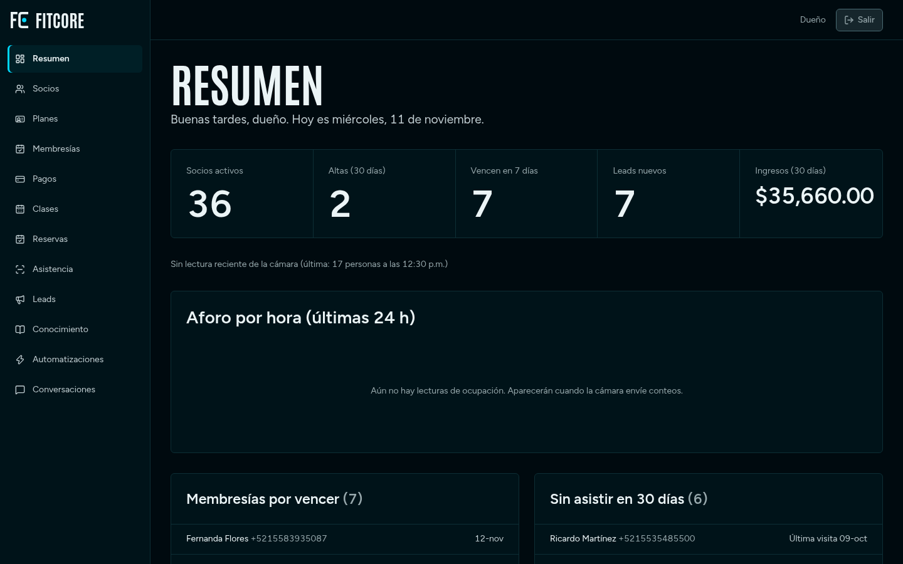
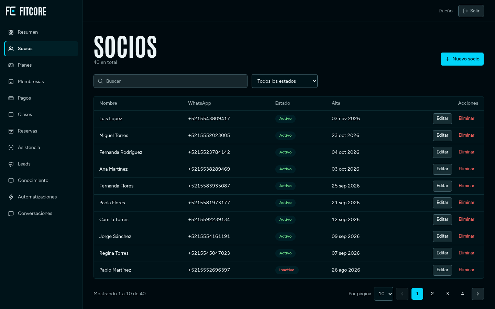
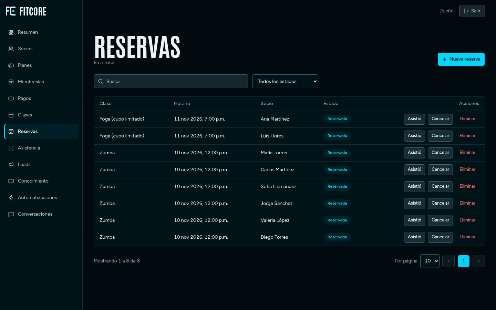
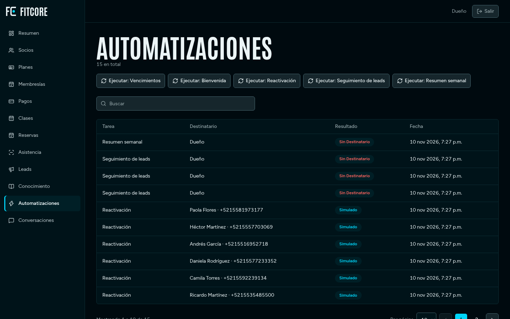
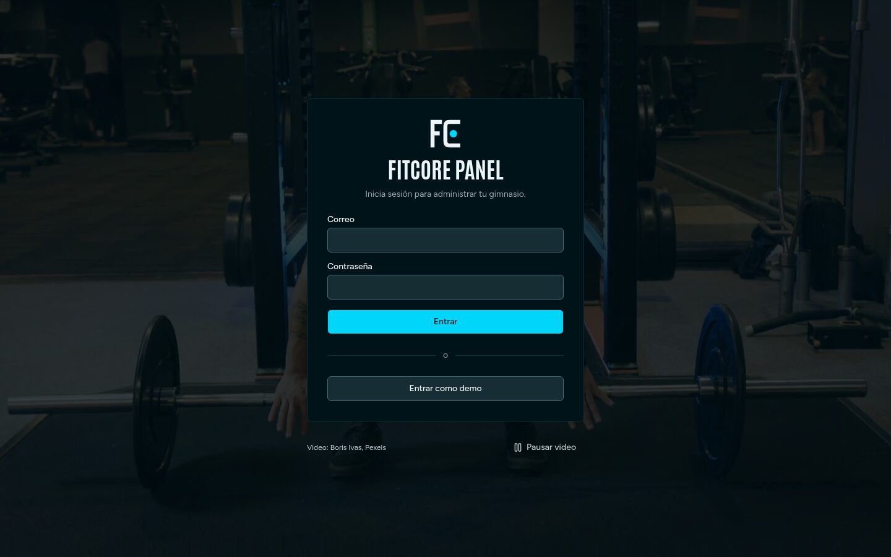
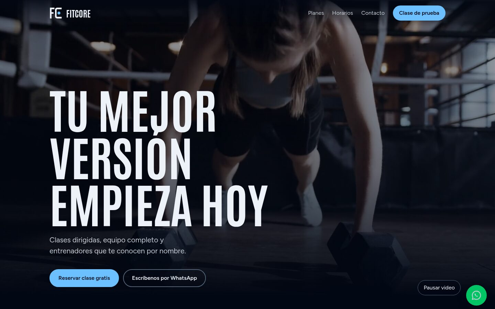
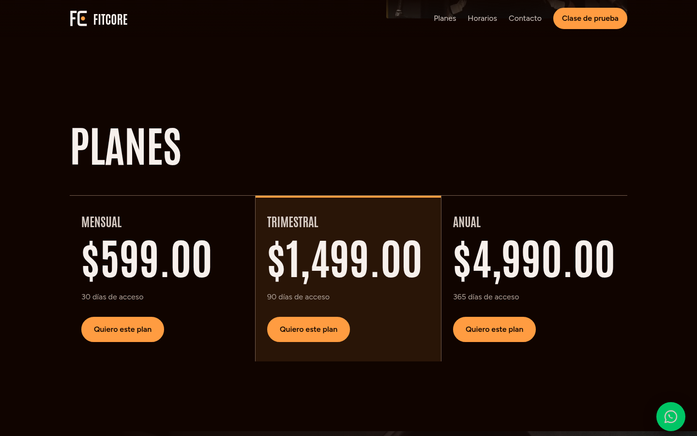
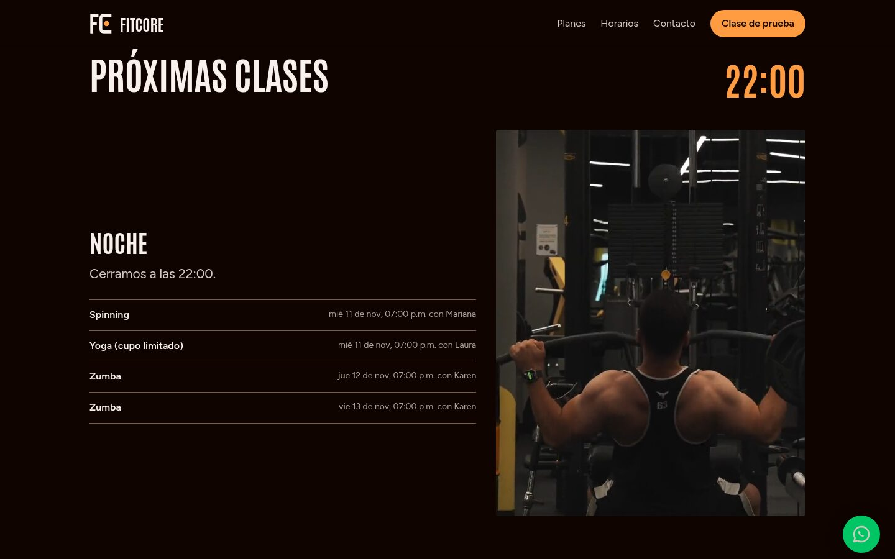
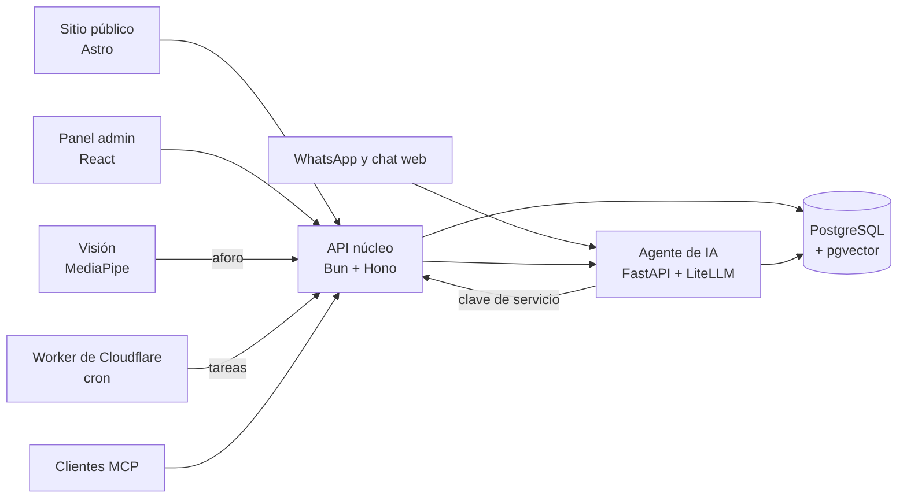

<p align="center">
  <picture>
    <source media="(prefers-color-scheme: dark)" srcset="assets/logo-dark.svg">
    
  </picture>
</p>

<h1 align="center">FitCore</h1>

<p align="center">
  Demo de un sistema a medida para gimnasios: panel de administración, sitio público,<br>
  agente de WhatsApp con IA, automatizaciones y conteo de aforo por visión por computadora.
</p>

<p align="center">
  
  
  
  
  
  
  
</p>

<p align="center">
  <a href="#capturas">Capturas</a> ·
  <a href="#arquitectura">Arquitectura</a> ·
  <a href="#stack-tecnológico">Stack</a> ·
  <a href="#instalación-y-arranque">Instalación</a> ·
  <a href="#integración-con-whatsapp">WhatsApp</a>
</p>

---

## Descripción

FitCore es una demo de [Quirelia Studio](#licencia-y-créditos) que muestra cómo luce un sistema armado a la medida de un gimnasio: en lugar de contratar varias herramientas sueltas, todo comparte una misma base de datos y una misma API.

El dueño ve su negocio en un panel (socios, membresías, pagos, clases, reservas y aforo en vivo), los clientes potenciales llegan desde un sitio público, y un agente de IA atiende por WhatsApp y por chat web: resuelve dudas con la información del propio gimnasio, consulta membresías, reserva clases y pasa la conversación al personal cuando no sabe. Además, tareas automáticas recuerdan vencimientos, dan la bienvenida y reactivan a socios inactivos.

> Todos los datos son ficticios. El proyecto es una demostración, no un producto en producción.

## Qué hace

- **Panel de administración** con roles: el dueño ve todo (incluidos pagos e ingresos) y recepción trabaja sin acceso a pagos ni a automatizaciones. Resumen con KPIs, membresías por vencer, socios sin asistir en 30 días y aforo por hora.
- **Sitio público** con planes y horarios que salen de la API, y un formulario de clase de prueba que crea un lead en el panel. Responsivo y con botón de WhatsApp.
- **Agente de IA** (WhatsApp y chat web) con RAG sobre el reglamento, planes, horarios y preguntas frecuentes. Herramientas: buscar conocimiento, consultar membresía, listar y reservar clases, consultar el aforo y escalar a una persona. Solo habla de los datos del teléfono que escribe.
- **Automatizaciones** programadas: recordatorio de vencimiento, bienvenida, reactivación, seguimiento de leads y resumen semanal. Son idempotentes y quedan registradas en el panel.
- **Aforo en tiempo real**: un worker de visión cuenta personas en un video o webcam y alerta cuando se supera el máximo configurado. Solo se guarda el número, nunca imágenes.
- **Servidor MCP de solo lectura** para que un cliente de IA consulte el negocio ("¿quién lleva 30 días sin venir?").

## Capturas

<table>
  <tr>
    <td width="50%"><br><sub><b>Panel · Resumen</b>: KPIs, aforo y vencimientos.</sub></td>
    <td width="50%"><br><sub><b>Panel · Socios</b>: búsqueda, filtros y paginación.</sub></td>
  </tr>
  <tr>
    <td><br><sub><b>Panel · Reservas</b>: asistencia y cancelaciones.</sub></td>
    <td><br><sub><b>Panel · Automatizaciones</b>: ejecución manual y bitácora.</sub></td>
  </tr>
  <tr>
    <td><br><sub><b>Panel · Acceso</b>: con cuenta de demostración.</sub></td>
    <td><br><sub><b>Sitio público · Portada</b>.</sub></td>
  </tr>
  <tr>
    <td><br><sub><b>Sitio público · Planes</b>, desde la API.</sub></td>
    <td><br><sub><b>Sitio público · Próximas clases</b>.</sub></td>
  </tr>
</table>

<p align="center">
  <br>
  <sub><b>Sitio público en móvil</b>.</sub>
</p>

## Arquitectura

Todos los servicios son clientes de una única API núcleo, la única con acceso al esquema de negocio. El servicio de IA solo toca las tablas del RAG y llama al núcleo con una clave de servicio.



## Stack tecnológico

| Capa | Tecnologías |
| --- | --- |
| **API núcleo** | Bun, Hono 4, Drizzle ORM, PostgreSQL (driver `postgres`), Better Auth, Zod 4, OpenAPI en `/openapi.json` |
| **Panel admin** | React 19, Vite 8, TypeScript, Tailwind CSS 4, TanStack Router y Query, React Hook Form, shadcn/ui sobre Base UI, Zustand, Sonner |
| **Sitio público** | Astro 7, React 19, Tailwind CSS 4, GSAP |
| **Agente de IA** | Python 3.12+, FastAPI, LiteLLM, Gemini (modelo de chat y de embeddings configurables), pgvector, httpx |
| **Visión** | Python 3.12+, MediaPipe (detección de personas en CPU) |
| **Automatizaciones** | Cloudflare Workers con Cron Triggers |
| **Mensajería** | WhatsApp Cloud API de Meta |
| **Integraciones** | Servidor MCP (`@modelcontextprotocol/server`) |
| **Datos e infraestructura** | PostgreSQL 16 con pgvector, Docker Compose |
| **Calidad** | `bun test` (núcleo), pytest (IA y visión), pruebas de humo y accesibilidad en navegador real (Playwright + axe-core), 30 preguntas de evaluación del agente |
| **Compartido** | `packages/shared`: esquemas Zod usados por el núcleo, el panel y la landing |

## Estructura del repositorio

```
.
├── apps/
│   ├── admin/          Panel del dueño y de recepción (React + Vite)
│   └── landing/        Sitio público (Astro)
├── services/
│   ├── core/           API, autenticación, tareas de automatización y servidor MCP
│   ├── ai/             Agente de WhatsApp y chat web, con RAG
│   └── vision/         Conteo de personas y reporte de aforo
├── automations/        Worker de Cloudflare que dispara las tareas
├── packages/shared/    Esquemas Zod compartidos
├── infra/              Docker Compose (Postgres + pgvector)
├── e2e/                Pruebas de humo del panel y de la landing
└── scripts/            Utilidades (ejecutar una tarea a mano)
```

## Requisitos

- [Bun](https://bun.sh) 1.x
- [Docker](https://www.docker.com) con Compose (para PostgreSQL)
- [uv](https://docs.astral.sh/uv/) y Python 3.12 o 3.13 (para los servicios de IA y visión)
- Una llave de la API de Gemini, solo para el agente de IA ([Google AI Studio](https://aistudio.google.com/apikey))

## Instalación y arranque

```bash
git clone https://github.com/Rafael-Ibarra-Beltran/fitcore-demo.git
cd fitcore-demo

bun install

bun run db:up            # Postgres + pgvector en Docker
bun run db:migrate
bun run db:seed          # datos ficticios y cuentas de demostración

bun run dev:core         # API        → http://localhost:3000   (contrato en /openapi.json)
bun run dev:admin        # Panel      → http://localhost:5173   (proxy /api → núcleo)
bun run dev:landing      # Sitio      → http://localhost:4321
```

El núcleo, el panel y el sitio arrancan sin archivos `.env`, con valores de desarrollo. Copia un `.env.example` a `.env` solo cuando necesites cambiar algo, y usa **la misma `SERVICE_KEY`** en el núcleo, el agente y la visión.

Agente de IA (necesita `GEMINI_API_KEY`):

```bash
cp services/ai/.env.example services/ai/.env        # agrega GEMINI_API_KEY y pon SERVICE_KEY=dev-service-key (o la que uses en el núcleo)
bun run ai:ingest        # genera los embeddings del RAG (o desde el panel: Conocimiento → Reindexar)
bun run dev:ai           # Agente     → http://localhost:8000
```

| Servicio | Puerto | Comando |
| --- | --- | --- |
| API núcleo | 3000 | `bun run dev:core` |
| Panel admin | 5173 | `bun run dev:admin` |
| Sitio público | 4321 | `bun run dev:landing` |
| Agente de IA | 8000 | `bun run dev:ai` |
| Visión | — (worker) | `bun run dev:vision` |

> Tras reiniciar la máquina, la base de datos no arranca sola: ejecuta `bun run db:up` antes de `dev:core`.

### Cuentas de demostración

Las crea `db:seed`, con datos ficticios.

| Rol | Correo | Contraseña |
| --- | --- | --- |
| Dueño | `demo@fitcore.test` | `demo-fitcore-2026` |
| Recepción | `staff@fitcore.test` | `demo-fitcore-2026` |

El botón **"Entrar como demo"** del login usa la cuenta del dueño. Recepción no ve Pagos ni Automatizaciones.

### Recorrido rápido

1. **Sitio público**: los planes y las clases salen de la API; envía el formulario y el lead aparece en el panel.
2. **Panel → "Entrar como demo"**: resumen con vencimientos, inactivos y aforo por hora.
3. **Reservas**: la primera clase tiene cupo 2 y está llena; intentar reservarla muestra el rechazo.
4. **Recepción**: entra como `staff@fitcore.test` y comprueba que no ve Pagos ni ingresos.

## Variables de entorno

Cada servicio trae un `.env.example` comentado. Las principales:

| Variable | Servicio | Descripción |
| --- | --- | --- |
| `DATABASE_URL` | core, ai | Conexión a PostgreSQL |
| `BETTER_AUTH_SECRET` | core | Secreto de sesiones (mínimo 32 caracteres) |
| `SERVICE_KEY` | core, ai, vision, automations | Clave compartida para las llamadas entre servicios |
| `SERVICE_ORG_SLUG` | core, ai | Organización con la que operan los servicios (`fitcore-demo`) |
| `ALLOWED_ORIGINS` | core, ai | Orígenes permitidos (CORS) |
| `OWNER_PHONE` | core | Teléfono del dueño: recibe el resumen semanal y los avisos de leads |
| `OCCUPANCY_MAX` | core | Aforo máximo; el panel alerta al superarlo |
| `MCP_API_KEY` | core | Clave del servidor MCP (vacía = apagado) |
| `GEMINI_API_KEY` | ai | Llave de Gemini |
| `LLM_MODEL`, `LLM_FALLBACK_MODEL`, `EMBED_MODEL` | ai | Modelos de chat, de respaldo y de embeddings |
| `DAILY_LIMIT` | ai | Mensajes por contacto y día (protege la cuota del LLM) |
| `WA_TOKEN`, `WA_PHONE_ID`, `WA_APP_SECRET`, `WA_VERIFY_TOKEN` | ai | Credenciales de la WhatsApp Cloud API |
| `VIDEO_SOURCE` | vision | Ruta de un video o `0` para la webcam |

Los archivos `.env` están en `.gitignore`: nunca subas llaves ni tokens.

## Pruebas

```bash
bun run test             # núcleo (requiere la base levantada y sembrada)
bun run test:ai          # agente de IA (no necesita la llave)
bun run test:vision      # visión (no necesita el modelo ni un video)
bun run test:e2e         # panel y landing en un navegador real, con accesibilidad (necesita core, admin y landing corriendo)
bun run ai:eval          # 30 preguntas de evaluación contra el agente real (~6 min, usa la llave de Gemini)
```

## Integración con WhatsApp

El agente funciona sin WhatsApp (chat web y pruebas con `curl`). Para conectarlo a un número real mediante la Cloud API de Meta:

1. **App en Meta.** En [Meta for Developers](https://developers.facebook.com/apps) crea una app con el caso de uso *Connect with customers through WhatsApp* y un portafolio de negocio. En *Use cases → Customize → Step 1* Meta asigna un **número de prueba**; agrega tu teléfono como destinatario (hasta 5) y confírmalo con el código que recibes por WhatsApp.
2. **Credenciales** en `services/ai/.env`: `WA_PHONE_ID` (Phone number ID), `WA_TOKEN` (el temporal caduca en horas; para algo duradero crea un token de usuario del sistema con permisos `whatsapp_business_messaging` y `whatsapp_business_management`), `WA_APP_SECRET` (*App settings → Basic*) y `WA_VERIFY_TOKEN` (un texto alfanumérico que inventas). Deja `WA_SKIP_SIGNATURE` vacío para validar la firma de los webhooks.
3. **URL pública.** Meta necesita HTTPS: en local usa un túnel, por ejemplo `cloudflared tunnel --url http://localhost:8000`.
4. **Webhook.** En *Step 2 → Configure Webhooks* pon `https://TU-TÚNEL/webhook` y tu `WA_VERIFY_TOKEN`, y suscribe el campo `messages`.
5. **Suscribe la cuenta a tu app**, necesario para recibir mensajes reales:
   ```bash
   curl -X POST "https://graph.facebook.com/v25.0/<WABA_ID>/subscribed_apps" -H "Authorization: Bearer $WA_TOKEN"
   ```
6. **Publica la app** (modo *Live*); en modo desarrollo el webhook solo recibe eventos de prueba. Para publicar, Meta pide una URL de política de privacidad.

A tener en cuenta:

- **Ventana de 24 horas.** Solo se puede escribir texto libre dentro de las 24 h posteriores al último mensaje del cliente. Fuera de ella hacen falta plantillas aprobadas.
- **Números de México.** Meta entrega los móviles como `521…` pero solo permite enviar a `52…`; el servicio lo normaliza y reconoce al socio con ambas formas.
- **Precios.** Los mensajes de servicio se cobran con 1.000 gratuitos al mes por número; consulta las tarifas vigentes en la [página de precios de Meta](https://developers.facebook.com/docs/whatsapp/pricing).
- **Cuota del LLM.** El plan gratuito de Gemini limita las peticiones y Google puede usar lo que se envía: úsalo solo con datos ficticios. Para clientes reales hace falta el nivel de pago.

## Automatizaciones

Cada automatización es una tarea del núcleo que un cron externo dispara con una llamada a `POST /internal/jobs/:nombre` y la clave de servicio. Son idempotentes (un reintento no duplica mensajes) y registran su resultado en el panel, en *Automatizaciones*.

| Tarea | Cuándo | Acción | Plantilla de WhatsApp |
| --- | --- | --- | --- |
| `recordatorio-vencimiento` | Diario, 10:00 | Avisa a quien vence en 3 días, con un enlace de pago de ejemplo | `fitcore_vencimiento` |
| `bienvenida` | Cada 15 minutos | Da la bienvenida a nuevos socios y leads con planes y clases | `fitcore_bienvenida` |
| `reactivacion` | Diario, 11:00 | Invita a socios sin asistir en 30 días con la próxima clase con lugar | `fitcore_reactivacion` |
| `seguimiento-lead` | Diario, 09:00 | Avisa al personal de un lead sin respuesta en 48 horas | `fitcore_seguimiento_lead` |
| `resumen-semanal` | Lunes, 08:00 | Envía al dueño altas, leads, ingresos, aforo pico y vencimientos | `fitcore_resumen_semanal` |

Los mensajes que inicia el gimnasio requieren **plantillas aprobadas** en WhatsApp Manager (español de México, con esos nombres exactos). Mientras no existan, o sin credenciales, las tareas se ejecutan y quedan registradas como **simuladas**.

```bash
bun run jobs:run bienvenida --dry     # muestra a quién se enviaría, sin registrar nada
bun run jobs:run recordatorio-vencimiento
```

En producción las dispara el Worker de `automations/` (Cron Triggers, horas en UTC):

```bash
cd automations && bun install
bunx wrangler secret put SERVICE_KEY
bunx wrangler deploy       # antes, pon la URL pública del núcleo en wrangler.toml
```

## Servidor MCP

El núcleo expone en `POST /mcp` un servidor [MCP](https://modelcontextprotocol.io) **de solo lectura**. Está apagado por defecto: sin `MCP_API_KEY`, `/mcp` responde 404.

```bash
openssl rand -hex 32            # genera la clave y pégala en services/core/.env como MCP_API_KEY
bun run dev:core                # reinicia el núcleo

npx @modelcontextprotocol/inspector --cli http://localhost:3000/mcp --transport http \
  --method tools/list --header "Authorization: Bearer $MCP_API_KEY"
```

| Herramienta | Qué devuelve |
| --- | --- |
| `resumen_negocio` | Socios activos, altas, vencimientos próximos, leads nuevos e ingresos de 30 días |
| `socios_inactivos(dias)` | Socios activos sin asistir en N días y su última visita |
| `membresias_por_vencer(dias)` | Membresías que vencen en N días, con nombre y teléfono |
| `buscar_socio(consulta)` | Hasta 10 socios por nombre o teléfono |
| `clases_proximas(dia?)` | Próximas clases con cupo libre |
| `aforo_actual()` | Último conteo de personas y su hora |
| `leads_nuevos(dias)` | Leads en estado `nuevo` |

La clave es distinta de `SERVICE_KEY` a propósito: solo da lecturas y no abre ninguna ruta de `/api`. La organización la fija el servidor, así que no hay forma de pedir datos de otra. Los datos incluyen nombres y teléfonos: trata la clave como un secreto.

## Visión por computadora

Un worker en Python (`services/vision`) lee un video o una webcam, cuenta personas con MediaPipe y manda el conteo al núcleo cada 60 segundos. El panel dibuja el aforo por hora y avisa cuando se supera `OCCUPANCY_MAX`; el agente de WhatsApp y el MCP leen la misma lectura.

```bash
cp services/vision/.env.example services/vision/.env     # define VIDEO_SOURCE (ruta de un video, o 0 para la webcam)
bun run dev:vision -- --once --dry    # cuenta el archivo e imprime cada muestra, sin publicar
bun run dev:vision                    # reporta de forma continua
```

- **Privacidad.** El proceso solo emite números enteros: no guarda, registra ni envía imágenes. Del núcleo solo se almacena cámara, conteo y hora.
- **Precisión.** El modelo subcuenta a personas pequeñas, lejanas o parcialmente tapadas. Antes de prometer cifras a un cliente, calibra `SCORE_THRESHOLD` con tu propio video usando `--once --dry`.
- **Video.** Usa uno propio, grabado con consentimiento de quienes aparecen, o la webcam. `services/vision/samples/` está en `.gitignore`.
- **Docker.** Para archivos de video: copia el video a `services/vision/samples/muestra.mp4` y ejecuta `docker compose -f infra/docker-compose.yml --profile vision up vision`.

## Estado del proyecto

Funciona completo en local. Pendiente de despliegue:

- Landing y panel en Cloudflare Pages.
- Núcleo y servicio de IA en Render.
- Base de datos en Supabase.
- Worker de `automations/` en Cloudflare.
- El módulo de visión corre en una máquina propia o con Docker, no en servicios gratuitos de nube por la memoria del modelo.

## Licencia y créditos

Distribuido bajo la licencia [MIT](LICENSE). © 2026 Quirelia Studio.

Los videos e imágenes del panel y del sitio público son de [Pexels](https://www.pexels.com) (licencia Pexels); sus autores están en `apps/admin/public/media/CREDITS.md` y `apps/landing/public/media/CREDITS.md`.
